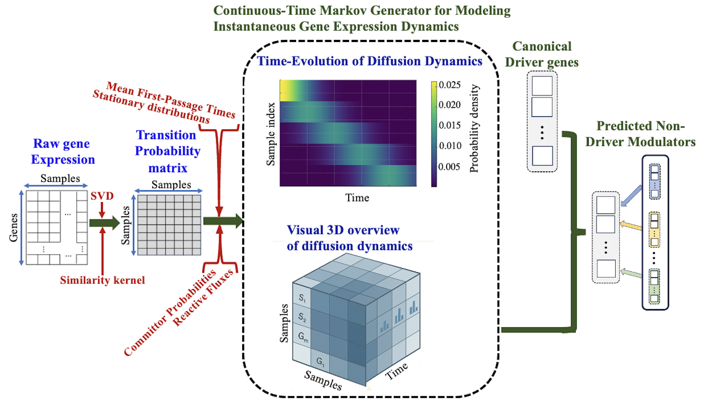

# DiMEXP

**Diffusion-Based Markov Modeling of Local-to-Global Gene Expression Dynamics for the Identification of Non-Driver Gene Modulators**


DiMEXP is an R framework for inferring regulatory influence in cancer transcriptomes. It models a cohort of expression profiles as a Markov process over samples, propagates expression along this diffusion structure, and applies Granger causality to the propagated profiles to identify **non-driver genes that modulate canonical cancer driver genes**.



---

## Contents

- [Motivation](#motivation)
- [Key features](#key-features)
- [Method overview](#method-overview)
- [Repository structure](#repository-structure)
- [Installation](#installation)
- [Quick start](#quick-start)
- [Inputs and outputs](#inputs-and-outputs)
- [Parameters](#parameters)
- [Example workflows](#example-workflows)
- [Data](#data)
- [Reproducibility](#reproducibility)
- [Computational notes](#computational-notes)
- [Citation](#citation)
- [License and contact](#license-and-contact)

---

## Motivation

Tumor behavior is shaped not only by recurrently mutated driver genes but also by a broader set of non-driver genes that tune driver activity. These modulators are hard to detect with standard tools:

- **Co-expression methods** (e.g., WGCNA) capture correlation but not direction or causality.
- **Variance-based decompositions** (PCA, ICA) emphasize dominant axes of variation and can mask weak, distributed regulatory signals.
- **Pairwise association methods** ignore the global structure of the sample population and are sensitive to noise and heterogeneity.

DiMEXP addresses these limitations by treating samples as states of a stochastic system. Expression is smoothed along the sample manifold according to local and global connectivity, which reduces noise and yields ordered, pseudo-temporal profiles on which directed (Granger) influence can be estimated.

## Key features

- **Robust sample graph:** PCA/SVD denoising, locally scaled Gaussian affinities, k-nearest-neighbor sparsification, and symmetrization.
- **Markov dynamics:** row-stochastic transition matrix with teleportation (guaranteed ergodicity) and a continuous-time generator.
- **Kinetic analysis:** stationary distribution, spectral coarse-graining into metastable states, mean first-passage times, committor probabilities, and reactive flux.
- **Expression propagation:** discrete- and continuous-time diffusion of gene expression with controlled stochastic perturbation.
- **Causal influence:** bivariate Granger causality (VAR models) between non-driver and driver genes, computed in parallel.
- **Modulator ranking and evaluation:** causal influence score (CIS) matrix, top influencers per driver, logistic modeling with cross-validated AUC, and in silico knockout.

## Method overview

DiMEXP runs in two stages.

### Stage 1: Diffusion-based Markov modeling (`Algorithm/dimexp_propagation.R`)

| Step | Description | Function |
|---|---|---|
| 1 | Center samples, reduce with SVD, compute squared Euclidean distances | `build_sample_markov()` |
| 2 | Locally scaled kernel $W_{ij}=\exp(-d_{ij}^2/\sigma_i\sigma_j)$, keep k nearest neighbors, symmetrize $W=\max(W,W^\top)$ | `build_sample_markov()` |
| 3 | Row-normalize to $P$ and add teleportation $P \leftarrow \alpha P + (1-\alpha)/N$ | `build_sample_markov()` |
| 4 | Continuous-time generator $Q=(P-I)/\Delta t$ | `estimate_Q_from_P()` |
| 5 | Stationary distribution $\zeta$ (left eigenvector of $P$ for eigenvalue 1) | `compute_stationary()` |
| 6 | Spectral embedding of $P_{sym}=(P+P^\top)/2$ and k-means coarse-graining | `compute_leading_eig()`, `coarse_grain_spectral()` |
| 7 | Mean first-passage time, committor, reactive flux | `mfpt_discrete()`, `committor_discrete()`, `reactive_flux_discrete()` |
| 8 | Propagate expression in discrete ($P$) and continuous ($e^{tQ}$) time with noise | `propagate_expression_discrete()`, `propagate_expression_continuous()` |

All steps are wrapped in a single call: `sample_markov_pipeline()`.

### Stage 2: Non-driver modulator identification (`Algorithm/dimexp_DriverModulator.R`)

| Step | Description | Function |
|---|---|---|
| 1 | Granger score $\mathcal{J}_{u\to v} = -\log_{10}(p_{uv}+10^{-10})$ from a bivariate VAR($p$) model | `compute_granger_score_safe()` |
| 2 | CIS matrix (non-drivers × drivers), computed in parallel | `compute_CIS_matrix_parallel()` |
| 3 | Top-ranked non-driver influencers for each driver | `get_top_influencers_per_driver()` |
| 4 | Cumulative influence and logistic model | `compute_transformation_likelihood()` |
| 5 | Stratified k-fold cross-validation, mean AUC | `evaluate_model_performance()` |
| 6 | In silico knockout and network visualization | `Run/run_pipeline_modulator.R` |

## Repository structure

```
DiMEXP/
├── Algorithm/
│   ├── dimexp_propagation.R        # Stage 1: Markov model, kinetics, propagation
│   └── dimexp_DriverModulator.R    # Stage 2: Granger/CIS, ranking, logistic model, AUC
├── Run/
│   ├── run_pipeline_propagation.R  # Example: propagation + line plots + heatmaps
│   └── run_pipeline_modulator.R    # Example: CIS, top influencers, network, knockout
├── Data/
│   ├── data_GSE21422_Research_7.rdata   # DCIS / invasive mammary carcinoma
│   └── data_GSE171415_Research_2.rdata  # Lung cancer in never smokers
├── Figure/
│   └── abstract.png                # Graphical abstract
└── README.md
```

## Installation

DiMEXP is a collection of R scripts and does not need to be installed as a package. Clone the repository and install the dependencies.

```bash
git clone https://github.com/komlanAtitey/DiMEXP.git
cd DiMEXP
```

```r
# R >= 4.0 recommended
pkgs <- c("Matrix", "MASS", "expm", "ggplot2", "reshape2", "vars",
          "tidyverse", "zoo", "dplyr", "igraph", "ggraph",
          "visNetwork", "scales", "pROC", "caret")
install.packages(setdiff(pkgs, rownames(installed.packages())))
# 'parallel' ships with base R
```

## Quick start

The example below runs both stages end to end on the bundled DCIS/mammary carcinoma dataset (GSE21422). Run it from the repository root.

```r
set.seed(1)

# Load DiMEXP functions
source("Algorithm/dimexp_propagation.R")
source("Algorithm/dimexp_DriverModulator.R")

# ---- Load data (genes x samples) ----
load("Data/data_GSE21422_Research_7.rdata")
X <- as.matrix(data_GSE21422_Research_7)   # numeric, gene symbols as row names
X[is.na(X)] <- 0

# ---- Stage 1: diffusion-based propagation ----
res <- sample_markov_pipeline(X,
                              k = 10,            # nearest neighbours
                              alpha = 0.99,      # teleportation
                              t_discrete = 5,    # diffusion steps
                              t_continuous = 5,
                              n_clusters = 3)    # metastable states

DiMEXP_data <- res$X_discrete
dimnames(DiMEXP_data) <- dimnames(X)
save(DiMEXP_data, file = "DiMEXP_data.rdata")  # used by Run/run_pipeline_modulator.R

# ---- Stage 2: non-driver modulators of driver genes ----
drivers     <- c("LTBP4", "BMP4", "GREM1")
non_drivers <- setdiff(rownames(DiMEXP_data), drivers)

CIS <- compute_CIS_matrix_parallel(DiMEXP_data,
                                   non_drivers = non_drivers,
                                   drivers     = drivers,
                                   max_lag = 2,
                                   ncores  = 4)

top <- get_top_influencers_per_driver(CIS, top_n = 5)
top$LTBP4                                     # top 5 modulators of LTBP4

lik <- compute_transformation_likelihood(CIS, drivers, rownames(DiMEXP_data))
auc <- evaluate_model_performance(lik$model_df, k = 5)
cat("Mean cross-validated AUC:", auc, "\n")
```

> **Note.** If your data frame stores gene symbols in a character column rather than in row names, use the preprocessing helper `process_genomic_data()` in `Run/run_pipeline_propagation.R` to separate the symbols from the numeric sample columns.

## Inputs and outputs

### Input

| Object | Format | Notes |
|---|---|---|
| Expression matrix `X` | numeric matrix, **genes × samples** | Gene symbols as row names, sample IDs as column names. Missing values should be imputed or set to 0. Normalized (e.g., log-scale) expression is recommended. |
| Driver genes | character vector | Must match row names of `X`; genes not found are dropped silently. |

### Output of `sample_markov_pipeline()`

| Element | Dimension | Description |
|---|---|---|
| `P` | N × N | Row-stochastic transition matrix (with teleportation) |
| `W` | N × N | Sparse, symmetric affinity matrix |
| `sigma` | scalar | Global kernel bandwidth (median heuristic) |
| `Q` | N × N | Continuous-time generator |
| `pi` | N | Stationary distribution (sample centrality) |
| `eig` | list | Leading eigenvalues/eigenvectors of $P_{sym}$ |
| `clusters` | list | `membership`, `centers`, `embedding`, `kmeans` object |
| `mfpt_discrete` | N | Mean first-passage time to cluster 1 |
| `committor_discrete` | N | Probability of reaching cluster 1 before cluster 2 |
| `reactive_flux` | N × N | Reactive flux between samples |
| `X_discrete` | G × N | Expression propagated with `P` |
| `X_continuous` | G × N | Expression propagated with $e^{tQ}$ |

### Output of Stage 2

| Function | Returns |
|---|---|
| `compute_CIS_matrix_parallel()` | Matrix of Granger scores, non-drivers (rows) × drivers (columns) |
| `get_top_influencers_per_driver()` | Named list, one data frame per driver: `Driver_Gene`, `Non_Driver_Gene`, `Influence_Score` |
| `compute_transformation_likelihood()` | `model_df` (gene, label, cumulative influence, predicted likelihood) and the fitted `glm` |
| `evaluate_model_performance()` | Mean AUC across valid folds |

## Parameters

| Parameter | Function | Default | Description |
|---|---|---|---|
| `k` | `sample_markov_pipeline` | 15 | Neighbours used for local scaling and graph sparsification |
| `alpha` | `sample_markov_pipeline` | 0.995 | Teleportation weight; smaller values add more uniform mixing |
| `npc` | `build_sample_markov` | 30 | Number of SVD components (capped at the matrix rank) |
| `delta_t` | `sample_markov_pipeline` | 1 | Time step used to form `Q` |
| `t_discrete`, `t_continuous` | `sample_markov_pipeline` | 5, 5 | Diffusion time; larger values give stronger, more global smoothing |
| `n_clusters` | `sample_markov_pipeline` | 4 | Number of metastable states (k-means) |
| `noise_level_rel`, `noise_level_abs` | `propagate_expression_*` | 0.05, 0.05 | Relative and absolute noise added during propagation |
| `max_lag` | `compute_CIS_matrix_parallel` | 2 | VAR model order $p$ |
| `ncores` | `compute_CIS_matrix_parallel` | 4 | Worker processes for the CIS computation |
| `top_n` | `get_top_influencers_per_driver` | 5 | Influencers reported per driver |
| `k` | `evaluate_model_performance` | 5 | Number of cross-validation folds |

**Practical guidance.** Use `k` between 5 and 20 for typical cohorts (tens to a few hundred samples); `k` must be smaller than the number of samples. Short diffusion times (`t` = 1–5) preserve local structure, while longer times emphasize global, metastable organization. `n_clusters` must be at least 2 because the kinetic analysis uses clusters 1 and 2 as target and source states.

## Example workflows

**1. Propagation and visualization.** `Run/run_pipeline_propagation.R` preprocesses a dataset, runs `sample_markov_pipeline()`, and compares original and propagated expression with line plots and heatmaps.

**2. Modulator identification.** `Run/run_pipeline_modulator.R` computes the CIS matrix, ranks the top influencers of each driver, reports cross-validated AUC, and draws an interactive driver–modulator network with `visNetwork`.

**3. In silico knockout.** The second half of `Run/run_pipeline_modulator.R` replaces the expression of each candidate modulator with near-zero noise, recomputes the Granger test against its driver, and plots $-\log_{10}(p)$ before and after knockout. A drop in significance indicates that the modulator contributes to the driver's dynamics.

**4. Kinetic analysis of the sample population.** The stationary distribution, clusters, MFPT, committor, and reactive flux returned by `sample_markov_pipeline()` can be used directly to study sample centrality and transitions between tumor states:

```r
head(sort(res$pi, decreasing = TRUE))   # most central samples
table(res$clusters$membership)          # metastable state sizes
summary(res$mfpt_discrete)              # expected steps to reach cluster 1
```

> The run scripts were written to be executed with the data files in the working directory. When running them from the repository root, change `load("data_...rdata")` to `load("Data/data_...rdata")` and `source()` the two files in `Algorithm/` first.

## Data

Two processed datasets are included in `Data/`. All four datasets analyzed in the accompanying study are publicly available from the NCBI Gene Expression Omnibus:

| Accession | Cancer type | Driver genes | Included |
|---|---|---|---|
| [GSE9891](https://www.ncbi.nlm.nih.gov/geo/query/acc.cgi?acc=GSE9891) | Serous and endometrioid ovarian cancer | TP53, BRCA1, BRCA2, ARID1A, PIK3CA, PTEN | No |
| [GSE171415](https://www.ncbi.nlm.nih.gov/geo/query/acc.cgi?acc=GSE171415) | Lung cancer in never smokers | EGFR, TP53, CHEK2, UBA1 | Yes |
| [GSE31519](https://www.ncbi.nlm.nih.gov/geo/query/acc.cgi?acc=GSE31519) | Triple-negative / basal-like breast cancer | GATA3, GPNMB, BHLHE41 | No |
| [GSE21422](https://www.ncbi.nlm.nih.gov/geo/query/acc.cgi?acc=GSE21422) | DCIS / invasive mammary carcinoma | LTBP4, BMP4, GREM1 | Yes |

## Reproducibility

- **Random seeds.** Propagation noise (`rnorm`), k-means initialization, cross-validation folds, and the knockout noise are stochastic. Call `set.seed()` before each stage to obtain identical results.
- **Parallel workers.** The CIS computation uses `parallel::parLapply`; results are deterministic for a given input, but runtime depends on `ncores`.
- **Parameters.** Record `k`, `alpha`, `t_discrete`, `t_continuous`, `n_clusters`, and `max_lag` with each run. The example scripts use `k = 10`, `alpha = 0.99`, `t = 5`, `n_clusters = 3`, and `max_lag = 2`.
- **Environment.** Save `sessionInfo()` alongside results to document R and package versions.

## Computational notes

- The affinity matrix is built with explicit loops over sample pairs and therefore scales as O(N²) in the number of samples. This is fast for cohorts of up to several hundred samples.
- The CIS step fits one VAR model per non-driver–driver pair, i.e., |non-drivers| × |drivers| models. For genome-wide runs, increase `ncores` or prefilter genes (e.g., by variance) to reduce runtime.
- Granger tests that fail to converge return a score of 0 and do not interrupt the run.

## Citation

If you use DiMEXP, please cite:

```bibtex
@article{atitey_dimexp,
  author  = {Atitey, Komlan},
  title   = {{DiMEXP}: Diffusion-Based Markov Modeling of Local-to-Global Gene
             Expression Dynamics for the Identification of Non-Driver Gene Modulators},
  journal = {IEEE/ACM Transactions on Computational Biology and Bioinformatics},
  year    = {2026},
  note    = {Under review}
}
```

Please also cite the original studies for any dataset you use (accessions listed under [Data](#data)).

## License and contact

License: to be specified (add a `LICENSE` file to the repository).

For questions, bug reports, or feature requests, please open an [issue](https://github.com/komlanAtitey/DiMEXP/issues) or contact Komlan Atitey (National Institute of Environmental Health Sciences).


